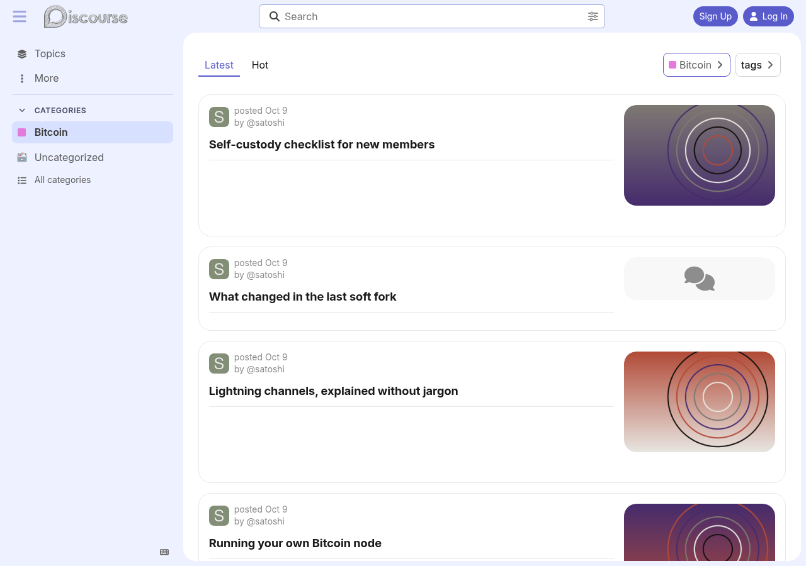
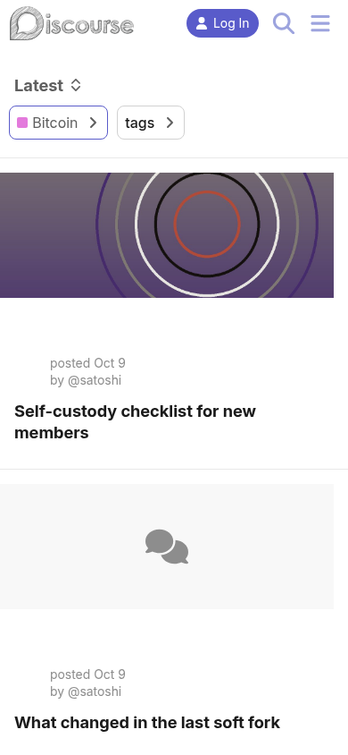

# Horizon Topic Thumbnails

[ENGLISH](README.md) | **ESPAÑOL**

Mantenido por Criptonautas. Sin afiliación ni respaldo de Discourse (Civilized Discourse Construction Kit, Inc.).

Añade miniaturas de tema a las **tarjetas de tema de alto contexto** de Horizon, al final de la
tarjeta, sin bifurcar ni editar el tema Horizon.

| Escritorio | Móvil |
|---|---|
|  |  |

## Cómo funciona

El diseño de alto contexto de Horizon registra una sola columna de lista de temas,
`high-context-card`, cuyo elemento renderiza toda la tarjeta como un único
`<td class="hc-topic-card">`. El núcleo renderiza el componente de cada columna como hijo directo
del `<tr>`, así que este componente registra su propia columna inmediatamente *antes* de la de
Horizon:

```js
columns.add("htt-thumbnail", { item: ThumbnailCell }, { before: "high-context-card" });
```

Eso da un `<td>` real hermano de la tarjeta, y la fila se maqueta como un contenedor
flex: primero la tarjeta y después la miniatura, sin posicionamiento absoluto.
Intercambia las columnas del grid en `common/common.scss` (y los dos valores de
`order` para móviles) para ponerla a la izquierda. En escritorio la fila es un grid,
así que el pie de la tarjeta ocupa todo el ancho bajo la imagen. Con `compact_last_reply`
activado (por defecto), la píldora de última respuesta de Horizon va en esa fila del pie,
justo antes de los contadores de respuestas y me gusta, en lugar de ocupar una línea propia.
Ambos quedan pegados al borde final de la tarjeta, bajo la imagen.

`about.json` declara `modifiers.topic_thumbnail_sizes`, que es lo que hace que el
servidor serialice `topic.thumbnails` en absoluto. El componente muestra entonces
`thumbnails[0]`, la **subida original**, en lugar de alguno de esos tamaños generados:
la celda es estrecha pero ocupa toda la altura de la tarjeta y se recorta con cover, así que en una
pantalla retina necesita muchos más píxeles de los que sugiere su ancho, y los tamaños generados
se amplían hasta quedar borrosos. El navegador reduce el original gratis. El componente oficial Topic List Thumbnails
no es necesario y no debe instalarse junto a este: pelea con el diseño de tarjetas de
Horizon.

## Requisitos

- Tema Horizon con **tarjetas de tema de alto contexto** activadas
  (`/admin/config/upcoming-changes`; activado por defecto en versiones recientes)
- Ajuste del sitio `create thumbnails` activado

## Instalación

1. Admin -> Personalizar -> Temas -> **Componentes** -> Instalar -> *Desde un repositorio git*
   (o sube este directorio como `.zip`).
2. Abre el tema **Horizon** -> Componentes -> añade *Horizon Topic Thumbnails*.

No se toca nada de Horizon. Quitar el componente revierte el cambio por completo.

Los tamaños de miniatura recién declarados se generan en segundo plano, así que los temas existentes
pueden mostrar el marcador de posición un tiempo antes de que aparezcan sus imágenes.

## Ajustes

| Ajuste | Por defecto | |
|---|---|---|
| `thumbnail_size` | `240` | Ancho de la columna de miniatura en px; la imagen ocupa toda la altura de la tarjeta y se recorta para ajustarse. |
| `mobile_thumbnails` | `true` | Muestra miniaturas en móvil, como un banner sobre la tarjeta. Ver más abajo. |
| `placeholder_icon` | `comments` | Icono para temas sin imagen, para que las tarjetas mantengan un ancho uniforme. Sirve cualquier nombre de icono. Si se deja vacío junto con `placeholder_background`, esas tarjetas ocupan el ancho completo. |
| `placeholder_background` | *(ninguna)* | Imagen detrás del icono de reemplazo. Sin ella, el reemplazo es un degradado suave del acento de la paleta (`--tertiary-very-low`) hacia su tono neutro (`--primary-very-low`), así que sigue los esquemas claro y oscuro. Con una imagen subida y `placeholder_icon` vacío, la imagen sola ocupa el espacio. |
| `compact_last_reply` | `true` | Mantiene más bajas las tarjetas con miniatura reutilizando la píldora de última respuesta de Horizon. Escritorio: la píldora pasa a la fila del pie, justo antes de los contadores de respuestas y me gusta. Móvil: sustituye la línea "publicado ... por". Ver más abajo. |
| `enabled_categories` | *(vacío)* | Muestra miniaturas solo al navegar estas categorías. Vacío = todas las listas de temas. |

### Móvil

Horizon fuerza su diseño de columnas de escritorio en móvil para los contextos de tarjeta, así que la
columna de miniatura también se renderiza en teléfonos. Su tarjeta móvil va deliberadamente de borde a
borde (`padding: var(--space-4) 0`, un pie a sangre completa con superposición de degradado,
una franja de etiquetas con desplazamiento horizontal) y nada de eso sobrevive a apretarse
en una fila más estrecha.

Así que no se aprieta. Por debajo del punto de corte `sm` de Horizon (40rem) la fila pasa a
`flex-direction: column`: la miniatura se convierte en un banner sobre la tarjeta y la tarjeta
recupera todo el ancho de la fila, exactamente como la dibuja Horizon. El banner lleva el mismo
margen `var(--space-4)` que Horizon da al contenido de la tarjeta en teléfonos y conserva las
esquinas redondeadas, así que queda alineado con el título de debajo.

Con `compact_last_reply` activado (por defecto), las tarjetas con píldora de última respuesta
quitan la cabecera de dos líneas "publicado ... por" de Horizon y muestran la píldora en su lugar,
para compensar la altura del banner. Los temas sin respuestas no tienen píldora y conservan la
cabecera original, y las insignias de estado (resuelto, cerrado) se mantienen. Desactívalo para
dejar la cabecera y la línea de contexto de Horizon exactamente como de serie, en escritorio y
en móvil.

`--htt-size` es el flex-basis de la celda en ambas direcciones, así que es el ancho de la columna
en escritorio y la altura del banner en móvil (140px).

Pon `mobile_thumbnails` en false para omitirlo: la comprobación está en JS, así que la columna nunca
se registra y la fila queda idéntica byte a byte al Horizon original.

### Alcance por categoría

El alcance es **a nivel de lista**, igual que el componente oficial: con
`enabled_categories` configurado, las miniaturas aparecen en `/c/<categoría>` para las
categorías elegidas y en ningún otro lugar; `/latest` y `/top` no tienen categoría y quedan
excluidos.

La comprobación lee `discovery.category` desde la celda al renderizar, *no*
`context.category` en el transformer `topic-list-columns`. Hay dos razones por las que ese
transformer no puede hacerlo: el núcleo construye su contexto a partir de
`topicTrackingState.filterCategory`, que no es la categoría de la ruta y
suele ser undefined, y `TopicList#columns` es `@cached`, así que el conjunto de columnas resuelto
no se reconstruye al navegar entre categorías.

Las celdas fuera de alcance se renderizan como `.htt-empty` (`display: none`), y la fila solo
se convierte en contenedor flex cuando hay una celda visible, así que una lista fuera de alcance se
maqueta exactamente como el Horizon original.

**Las subcategorías no se dan por incluidas.** Listar una categoría padre no habilita a sus
hijas; añade cada subcategoría explícitamente. (Si quieres que los padres se propaguen, es
un cambio de dos líneas en `enabledForCategory`.)

## Alcance del componente

La columna solo se registra cuando existe `high-context-card`. Las listas de temas sugeridos y
relacionados usan la tarjeta simple de Horizon, y los temas que no son Horizon no registran esa
columna, así que ninguno recibe una celda de miniatura.

## Prueba

```
node scripts/thumbnail-source.test.mjs
```

Cubre la selección de srcset/src (miniaturas ausentes, redimensiones no generadas, tamaños de visualización
mayores que cualquiera producido por el servidor) y la lista de categorías permitidas.

## Techo conocido

Depende de tres nombres de Horizon: la clave de columna `high-context-card` y las clases
`--high-context` y `.hc-topic-card`. Si Horizon renombra alguno, las miniaturas
dejan de renderizarse en silencio; la tarjeta en sí no se ve afectada. La solución es un renombrado en
`api-initializers/horizon-topic-thumbnails.gjs` y `common/common.scss`. El diseño también
coloca las partes de la tarjeta por sus clases `.hc-topic-card__*` (cabecera, contenido,
contexto, pie y sus hijos); un renombrado ahí deja esa pieza fuera de sitio.

## Licencia

MIT. Consulta [LICENSE](LICENSE).

Texto de este README bajo [CC BY-NC-SA 4.0](CC-BY-NC-SA-4.0.txt).
